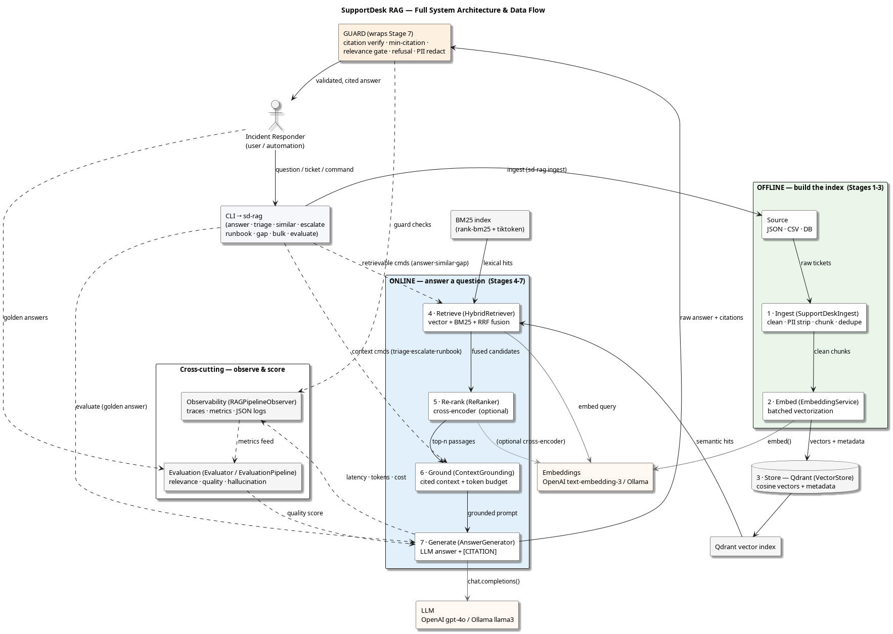

<!--
Copyright (C) 2026 Tonworio (Ton) Oguara
SPDX-License-Identifier: MIT
-->

# Building a Production-Ready RAG System for Support-Desk Tickets

> **Author:** Ton Oguara — Principal Software Engineer
> **Stack:** Python 3.14 · OpenAI (gpt-4o-mini) / Ollama · Qdrant · rank-bm25 · sentence-transformers · `uv`
> **Audience:** software engineers and AI engineers who know the basics of LLMs — prompts, tool-calling, maybe a few embeddings — and want to see a *real, working* end-to-end RAG system: the actual classes, the actual failure modes, and the guardrails that keep it honest. You don't need to know the RAG vocabulary in advance — every term is explained at first appearance. Not a toy.

---

A support desk is a time machine. The question a customer is asking right now has almost certainly been asked before, answered before, and written down — somewhere — in a ticket. The problem is never that the knowledge is missing. It's that the knowledge is *scattered*: half in a ticketing database, half in a CSV, half in a resolution note that no one reads, and a quarter of it is an email address that legally shouldn't be sitting inside a prompt.

Retrieval-Augmented Generation (RAG) is the obvious answer to that: search the past, stuff the relevant pieces into a prompt, let the LLM synthesize — the model answers from *your* evidence, not from its memory alone. And most RAG tutorials stop there — retrieve, stuff, generate — ship it, and discover in week two that the assistant is confidently inventing ticket numbers, echoing the customer's own email address back to them, and answering billing questions with network-troubleshooting context.

This article walks through the design and implementation of **SupportDesk RAG**, a system that answers support questions with *cited* answers drawn from ticket history. The design goal was never "call an LLM." It was: *every claim the system makes has to point at a ticket that actually exists, and the system has to be able to say "I don't know" when the context doesn't support an answer.* That single requirement is what determines most of the architecture that follows.

The shape of the system is deliberately boring: **seven stages in a line — Ingest, Embed, Store, Retrieve, Re-rank, Ground, Generate — plus one wrapper around the end (a Guard) that enforces citations, a relevance gate, and PII redaction**, and a cross-cutting layer of observability and evaluation. Every diagram in this article is reproducible from the PlantUML source in the repo, and every code snippet is lifted from the working codebase.

You don't need to be a support-ops person to follow this. The value is in a repeatable pattern for turning "a pile of past tickets" into a grounded, auditable, *honest* answering service.

## High-level overview


That one picture is the whole architecture. The rest of the article is about how each box is built, and — more importantly — where the boxes would quietly go wrong if I'd built them the lazy way.

---

## 1. Why this shape, and why "a line + a wrapper"

Before writing code, it's worth being clear about what this is *not*. A support-answer assistant is **not** a multi-agent problem. There's no router, no fleet of specialized agents, no merge node. It's a *pipeline* — and that's the right call, because there's exactly one job: **find the evidence, then answer from it**.

The decision I'd push back on hardest in a code review is the naive one: *ask a big model to "search the tickets and answer"* and call it done. That conflates two fundamentally different problems — **retrieval**, which is deterministic, testable, and where your bugs should live, and **generation**, which is probabilistic and where hallucination lives — into one undifferentiated LLM call. You lose the ability to unit-test retrieval, to log *which* tickets were considered, and to reject a bad answer *after* it's produced. SupportDesk RAG keeps them separate, and every design choice below falls out of that separation.

Here's the capability list I designed against, straight from the design brief:

1. Answer a customer question with **citations to source tickets**
2. **Triage** an incoming ticket (category + urgency + troubleshooting steps)
3. Find **similar past tickets** to the current issue
4. Generate an **escalation handoff** summary
5. Detect **knowledge gaps** across tickets
6. **Bulk** analyze a batch of tickets
7. **Refuse** — say "I can't answer" — when the context doesn't support it

Capability 7 is the one that most often gets skipped in naive implementations, and it's the one that most separates a demo from a system a support lead will actually trust. A RAG system that *never* says "I don't know" is a RAG system that will, eventually, be wrong with confidence. We'll come back to it in the Guard section.

The two halves map cleanly onto offline/online:

| Half | Stages | When it runs | What it costs |
|---|---|---|---|
| **Offline** (build the index) | 1 Ingest → 2 Embed → 3 Store | When new tickets arrive; batch | Embedding API + storage |
| **Online** (answer a question) | 4 Retrieve → 5 Re-rank → 6 Ground → 7 Generate → Guard | Every customer question | Embedding + LLM + cross-encoder |

That split is the load-bearing structural decision. The offline half runs *as often as your data changes*; the online half runs *as often as you have questions* and has to be fast, cheap, and honest. Keeping them separate is why you can swap the embedding model offline without touching the query path, and why you can test the online half against a *fixed* index.

The full architecture, including the CLI surface, the retrieval internals (vector index + BM25), the Guard, and the cross-cutting observability/evaluation layer, looks like this:



---

## 2. Stage 1 — Ingest: clean, chunk, dedupe, and attach *metadata*

The unglamorous truth of RAG is that **garbage in is hallucinations out.** Retrieval can only find what was put in the index, and it can only find it *well* if the chunks are shaped so that each one answers a coherent question.

Ingest does four things in order, and the order matters. The implementation is `SupportDeskIngest` in `supportdesk_ingest.py`:

```python
# src/supportdesk_rag/supportdesk_ingest.py (abridged)
import csv
import json
import re
from typing import List, Dict
import tiktoken
from langchain_text_splitters import RecursiveCharacterTextSplitter

class SupportDeskIngest:
    def __init__(self, chunk_size: int = 1000, chunk_overlap: int = 150,
                 chunk_type: str = "recursive"):
        self.chunk_size = chunk_size
        self.chunk_overlap = chunk_overlap
        self.chunk_type = chunk_type
```

Four design points from the actual code:

**1. Combine `description` and `resolution_notes` before chunking.** This is the single highest-value ingest decision. The *question* is in the description; the *answer* — the part a future search will want — is usually in the resolution notes. Keep them separate and you index thousands of "I can't login" chunks with no signal about *why* or *how it was fixed*. The code concatenates them:

```python
# supportdesk_ingest.py, process_tickets (abridged)
ticket_text = ticket["description"]
if ticket.get("resolution_notes") and ticket["resolution_notes"].strip():
    ticket_text += "\n\nResolution: " + ticket["resolution_notes"]
```

**2. PII cleaning — personally identifiable information: email addresses, card-like digit runs, SSNs — is applied *before* chunking.** Tickets are full of email addresses and card-like digit runs. Cleaning before you split means the PII can't straddle a chunk boundary and leak out of a redaction pass you thought had already run. `clean_text` is a small, explicit, regex-only pass — no model in the loop, which is exactly what you want for a deterministic safety step:

```python
# supportdesk_ingest.py (abridged)
def clean_text(self, text: str) -> str:
    pii_patterns = [
        (r'\b\d{3}-\d{2}-\d{4}\b', '[SSN_REDACTED]'),
        (r'\b\d{16}\b', '[CARD_REDACTED]'),
        (r'\b[A-Za-z0-9._%+-]+@[A-Za-z0-9.-]+\.[A-Z|a-z]{2,}\b', '[EMAIL_REDACTED]'),
    ]
    for pattern, replacement in pii_patterns:
        text = re.sub(pattern, replacement, text)
    text = re.sub(r'\s+', ' ', text).strip()
    return text
```

**3. Recursive chunking at 1000/150.** `RecursiveCharacterTextSplitter` splits at natural boundaries (`\n\n`, `\n`, sentence ends, spaces) before falling back to hard cuts, so a sentence rarely gets torn mid-thought. 1000 tokens (a token is the model's counting unit — a small fragment of a word, roughly one per three-quarters of a word — so 1000 tokens ≈ 700–800 words) keeps a full “problem → context → resolution” unit in one chunk; 150 tokens overlap ensures a fact that straddles a boundary still survives retrieval. The trade-off is inherent: bigger chunks carry more context but more noise; smaller chunks are more precise but risk splitting a question from its answer. For freeform tickets, the recursive splitter is the right default — token-exact and semantic chunking both cost more for a support corpus that isn't that structured.

**4. Metadata is attached per chunk and is the actual retrieval contract.** Each chunk carries `ticket_id`, `chunk_index`, and a `metadata` block — `service`, `severity`, `ticket_type`, `created_at`, `user_name`, `user_email`. This is not decoration: it's what lets Stage 4 filter "only high-severity network tickets" and it's what the Guard in Stage 8 uses to know which ticket IDs are *legally* citable. The `ticket_id` in particular is the thread that runs through everything — it's on the index, in the citation markers, and in the guard's allow-list.

Deduplication here is deliberately simple — exact-string dedupe on `chunk_text` — because at ingest time you don't have embeddings yet, and semantic dedupe belongs to a later, more expensive pass. Cheap and correct beats clever and slow for a pre-embedding stage.

---

## 3. Stage 2 — Embed: batch it, and don't let one bad batch kill the run

Embedding is where you stop having text and start having data: an *embedding* is the output of an encoding model — a vector of hundreds or thousands of floating-point numbers whose geometry encodes meaning, so that texts with similar meaning land near each other in that space and “find similar tickets” becomes a nearest-neighbor search over vectors. The two engineering requirements are (a) **batch it** so you're not making one API call per chunk, and (b) **be forgiving** so a single failed batch doesn't abort an ingest of thousands of tickets.

`EmbeddingService` in `supportdesk_embed.py` is a thin OpenAI-compatible client (the same client works against Ollama via a base-URL swap — see §7):

```python
# src/supportdesk_rag/supportdesk_embed.py (abridged)
class EmbeddingService:
    def __init__(self, model=None, batch_size=None):
        self.config = Config()
        self.model = model or get_embedding_model_name()
        self.batch_size = batch_size or self.config.get_embed_config().get("batch_size", 100)
        self.dimensions = self.config.get_openai_config().get("embedding_dimensions", 1536)
        kwargs = get_client_kwargs()
        self.client = openai.OpenAI(**kwargs)

    def embed_batch(self, texts: List[str], batch_size: Optional[int] = None) -> List[List[float]]:
        bs = batch_size if batch_size is not None else self.batch_size
        embeddings = []
        for i in tqdm(range(0, len(texts), bs), desc="Embedding batches"):
            batch = texts[i:i + bs]
            try:
                response = self.client.embeddings.create(
                    input=batch, model=self.model, encoding_format="float"
                )
                embeddings.extend([d.embedding for d in response.data])
            except Exception as e:
                print(f"Batch {i//bs} failed: {e}")
                embeddings.extend([[0.0] * self.dimensions for _ in batch])
        return embeddings
```

Two things to note. First, `EmbeddingPipeline.process_chunks` attaches each vector to its chunk **and assigns a UUID if one isn't present** — so the store never has to invent IDs later. Second, the `except` branch pads a zero vector rather than raising. That's a deliberate "log and continue" posture for a batch job: you'd rather ingest 9,999 of 10,000 and see the warning than lose the whole run, and the zero vectors are detectable and re-embeddable. (For an *online* query path you would raise — different failure semantics, different half of the system. That asymmetry is the point of §1.)

A subtle correctness detail lives in the store: the embedding **dimension must match the collection**, or Qdrant will reject the upsert. `get_embedding_model_dimensions` in `supportdesk_store.py` returns a model-specific dimension, falling back to `4096`:

```python
# src/supportdesk_rag/supportdesk_store.py, get_embedding_model_dimensions (abridged)
dimensions_map = {
    "text-embedding-3-small": 1536,
    "text-embedding-3-large": 3072,
    "text-embedding-ada-002": 1536,
}
explicit_dims = config.get("openai", "embedding_dimensions", default=None)
if explicit_dims is not None:
    return explicit_dims
return dimensions_map.get(model, 4096)
```

This matters because the codebase defaults to Ollama's `qwen3-embedding:latest` (4096-dim) rather than OpenAI's 1536-dim models — swap the model and the collection dimension has to swap with it, or every upsert fails. It's the classic "the vector store has a memory you don't share" bug, handled by deriving the dimension from the *active* model at initialization instead of hard-coding it.

---

## 4. Stage 3 — Store: Qdrant, cosine distance, and metadata as a first-class citizen

Storage is the one stage where the *choice of database* is doing real work, not just holding data. Qdrant is chosen here for three specific reasons the design brief calls out: fast approximate-nearest-neighbor top-k search (its HNSW index), **first-class metadata filtering**, and a clean gRPC/HTTP surface. Filtering is *why* a support RAG uses a vector DB rather than a bare in-process index — you literally cannot ask "only `severity=high`, only `service=network`" in FAISS.

`VectorStore` creates the collection with cosine distance — the angle between two vectors, where 1 means same direction and 0 means orthogonal (embeddings are normalized-ish, so cosine is the natural metric) and wraps the qdrant-client. The piece that makes Stage 4 possible is `filtered_search`, which turns a small set of business filters into Qdrant `FieldCondition`s:

```python
# src/supportdesk_rag/supportdesk_store.py (abridged)
def filtered_search(self, query_vector, service=None, severity=None,
                    ticket_type=None, top_k: int = 10):
    conditions = []
    if service:
        conditions.append(FieldCondition(key="service", match=MatchValue(value=service)))
    if severity:
        conditions.append(FieldCondition(key="severity", match=MatchValue(value=severity)))
    if ticket_type:
        conditions.append(FieldCondition(key="ticket_type", match=MatchValue(value=ticket_type)))
    return self.search(query_vector, top_k=top_k, filter_conditions=conditions)
```

That's the whole offline half. Ingest → Embed → Store produces a collection where every point is `(vector, payload)` and the payload carries the `ticket_id`, `service`, `severity`, `ticket_type` that the rest of the system depends on. `StorePipeline.store_chunks` builds those payloads and validates dimension parity before upserting, reporting `{stored, failed, skipped, collection, total_points}` so a run is auditable.

---

## 5. Stage 4 — Retrieve: hybrid search, and why RRF is the "don't tune it" answer

**This is the stage that decides whether the system is good.** A semantic retriever alone will happily pull the wrong "password reset" ticket because another ticket was also *about* passwords. A pure keyword retriever alone — BM25 is a classic scoring scheme that measures how *literally* words match — will miss the ticket that answers your question but phrases it differently. In real ticket corpora — full of error codes, version numbers, product names, and the "service unavailable" vs. "HTTP 503" mismatch — *both* signals matter, and neither is sufficient.

The implementation (`HybridRetriever` in `supportdesk_retrieve.py`) retrieves from **both** a vector index and a BM25 index, then fuses them with **Reciprocal Rank Fusion**. The BM25 index is built *from the vector store itself* at init — scroll the payloads, build `rank_bm25.BM25Okapi` over the `chunk_text` fields — so there's exactly one source of truth:

```python
# src/supportdesk_rag/supportdesk_retrieve.py (abridged)
def retrieve(self, query, top_k=10, query_embedding=None,
             vector_top_k=None, bm25_top_k=None):
    vector_k = vector_top_k or self.vector_top_k      # default 20
    bm25_k = bm25_top_k or self.bm25_top_k            # default 20

    if query_embedding is None:
        query_embedding = self.embedding_service.embed_text(query)

    # 1. Vector search (semantic)
    vector_results = self.vector_store.search(query_vector=query_embedding, top_k=vector_k)
    # 2. BM25 search (lexical)
    bm25_results = self.bm25_index.search(query, top_k=bm25_k) if self.bm25_index else []
    # 3. Fuse with RRF
    fused_results = self.rrf_fusion(vector_results, bm25_results, k=self.k_rrf)
    return fused_results[:top_k]
```

RRF is the part I want to defend, because "we're just summing inverse ranks" sounds like a cop-out. It isn't — it's *the* standard answer to merging two *rank-ordering* signals whose **scores are on incompatible scales** (a cosine similarity in [0,1] is not comparable to a BM25 score). You cannot add a `0.62` to a `47.3` and call it relevance. RRF sidesteps scale entirely by working on *ranks*:

```python
# supportdesk_retrieve.py, rrf_fusion (abridged)
# RRF Formula: fused_score(doc) = sum( 1 / (k + rank_i(doc)) )  for each retriever i
for rank, result in enumerate(vector_results, start=1):
    doc_id = result.get("id") or result.get("doc_id")
    if doc_id:
        fused_scores[doc_id] = {"score": 1 / (k + rank), "vector_rank": rank, "bm25_rank": None}

for rank, result in enumerate(bm25_results, start=1):
    doc_id = result.get("doc_id")
    if doc_id:
        if doc_id in fused_scores:
            fused_scores[doc_id]["score"] += 1 / (k + rank)
            fused_scores[doc_id]["bm25_rank"] = rank
        else:
            fused_scores[doc_id] = {"score": 1 / (k + rank), "vector_rank": None, "bm25_rank": rank}

sorted_docs = sorted(fused_scores.items(), key=lambda x: x[1]["score"], reverse=True)
```

Three properties make RRF the right default here. **Parameter-free:** `k=60` is the standard constant, not a knob to tune per corpus. **Robust to a weak retriever:** a document only a mediocre retriever found still scores something; a document both found high scores *double*. **Consensus-rewarding:** the doc that appears in both top lists rises naturally, which is exactly the "two independent methods agree this is the ticket" signal you want. The config sets `k_rrf: 60`, `vector_top_k: 20`, `bm25_top_k: 20` — retrieve generously, fuse, then truncate.

One honest caveat, stated in the design doc: hybrid search adds retrieval latency (you pay for two retrievals) and the in-process BM25 index here is the *demo-grade* implementation. For a corpus in the hundreds of thousands, the brief's recommendation is to move BM25 to a dedicated engine (Elasticsearch/OpenSearch) or Qdrant's native hybrid — the RRF fusion logic stays identical, only the two "retrievers" change. That's the beauty of this stage: **the fusion strategy is decoupled from the retrieval backends**, so you upgrade the backends without touching the correctness of the merge.

---

## 6. Stage 5 — Re-rank: the cross-encoder is precision, not recall

Re-ranking is the "second opinion" stage. The first pass (hybrid + RRF) is a *bagginess* retriever: it's fast, it's good at recall, but it's coarse at ordering. A **cross-encoder** re-scores the *query–passage pairs together*, which is far more precise — and far more expensive. So you never re-rank the whole corpus; you re-rank the top-20ish the first pass gave you, and take the top-n.

```python
# src/supportdesk_rag/supportdesk_rerank.py (abridged)
class ReRanker:
    def __init__(self, model_name=None, min_score: float = -5.0, batch_size: int = 32):
        from sentence_transformers import CrossEncoder
        config = Config()
        self.model_name = model_name or config.get_rerank_config().get(
            "model", "cross-encoder/ms-marco-MiniLM-L-6-v2")
        self.min_score = min_score
        self.batch_size = batch_size
        self.model = CrossEncoder(self.model_name)

    def rerank(self, query, documents, top_k=None):
        if not documents:
            return []
        if top_k is None:
            top_k = Config().get_rerank_config().get("top_k", 10)
        pairs = [(query, _get_document_content(doc)) for doc in documents]
        scores = self.model.predict(pairs, batch_size=self.batch_size)
        for doc, score in zip(documents, scores):
            doc["rerank_score"] = float(score)
        documents.sort(key=lambda x: x["rerank_score"], reverse=True)
        return documents[:top_k]
```

The model is `cross-encoder/ms-marco-MiniLM-L-6-v2` — a deliberately small, local cross-encoder, so re-ranking adds **no cloud cost** and no latency beyond a local inference pass. That's the bi-encoder vs. cross-encoder trade-off made concrete: the vector store's bi-encoder is cheap and independent (encodes query and doc separately), the cross-encoder is expensive and joint (encodes the *pair*). You pay the expensive one only on the short list.

**A detail I'd flag in review:** in the *shipped* config, re-ranking is **off** — `rerank.enabled: false`, with the comment "Disable re-ranking for domain-specific use cases (no fine-tuned model)." This is an honest design decision, not a bug: a *generic* ms-marco cross-encoder is only as good as its pre-training distribution, and on a narrow support corpus it can re-order you *away* from the right ticket. The code is fully built, tested, and gated — so you can flip it on once you've fine-tuned or validated a domain re-ranker. The whole point of making Stage 5 a *switch* in `SupportDeskRAGPipeline` is that the pipeline degrades *gracefully*: with re-ranking off, the online path falls back to raw hybrid ordering and nothing else breaks.

---

## 7. Stage 6 — Ground: assemble a *cited* context, not a wall of text

This is the stage most RAG systems skip or do badly. The naive version is "join all the retrieved passages with newlines and stuff it in the prompt." SupportDesk RAG's `ContextGrounding` does the job properly, and the reason it matters is that **this output is the contract the LLM is allowed to quote from.**

`ground_context` filters by a minimum relevance score, takes the top-n passages, and wraps each one in a **citation marker** — `[CITATION:ticket_id]` — before concatenating:

```python
# src/supportdesk_rag/supportdesk_ground.py (abridged)
def ground_context(self, reranked_results, query=None, embedding_service=None):
    # 1. Filter by minimum relevance score
    relevant_results = [
        r for r in reranked_results
        if r.get("rerank_score", r.get("score", float('-inf'))) >= self.min_relevance_score
    ]
    # 2. Sort by score
    relevant_results.sort(key=lambda x: x.get("rerank_score", x.get("score", float('-inf'))), reverse=True)
    # 3. Take top-n
    selected = relevant_results[:self.max_passages]

    context_parts = []
    citations = []
    for i, result in enumerate(selected):
        passage = ...  # resolved from payload.chunk_text / chunk_text / document
        ticket_id = ...  # resolved from payload.ticket_id / ticket_id / id / "passage_{i}"
        context_parts.append(f"[CITATION:{ticket_id}]\n{passage}\n")
        citations.append({
            "citation_id": f"[CITATION:{ticket_id}]",
            "ticket_id": ticket_id,
            "score": result.get("rerank_score", result.get("score", 0)),
            "rank": i + 1,
            "retriever": result.get("retriever", "unknown"),
            "content_preview": passage[:100] if passage else "",
        })
    context_text = "\n---\n".join(context_parts)
    estimated_tokens = len(context_text) // 4
    return GroundedContext(context_text=context_text, citations=citations,
                           relevance_scores=[c["score"] for c in citations],
                           total_tokens=estimated_tokens)
```

Three things in that block are load-bearing:

- **The `citations` list is the allow-list.** It's the same structure the Guard later verifies *against*. The grounding stage decides which ticket IDs exist; the Guard decides whether the answer stayed within that set. Grounding and Guard are two ends of the *same* contract.
- **Token budgeting is explicit.** `max_tokens: 4000`, `max_passages: 5`, `min_relevance_score: -3.0`, and a `truncate_context` that drops the lowest-scoring passages first when the context overflows. You're choosing context size, not discovering it.
- **Defensive field resolution.** The code resolves `passage` from several possible locations (`payload.chunk_text`, `chunk_text`, `document`) and `ticket_id` from `payload.ticket_id`, `ticket_id`, `id`, or a generated `passage_{i}`. That's the code being robust to the upstream stages having slightly different shapes — and it's the *exact* kind of thing that makes a RAG pipeline work when you swap a retriever backend in §5.

---

## 8. Stage 7 — Generate: a grounded prompt, low temperature, and an explicit *refusal instruction*

The LLM call itself is small. What's not small is the **prompt contract**, because the model is only allowed to do one thing: synthesize the context and attach the citation markers. `AnswerGenerator` encodes that contract into the system prompt and uses a low temperature to suppress the "but I *think* there's also…" tail where hallucination lives:

```python
# src/supportdesk_rag/supportdesk_generate.py, generate_answer (abridged)
default_system_prompt = """
You are a support desk assistant answering incident tickets.
Your answer MUST be grounded ONLY in the provided context.
Follow these rules STRICTLY:

1. Use ONLY information from the provided context
2. Add citation markers like [CITATION:ticket_id] after each claim
3. If the context doesn't contain enough information, say "I cannot find sufficient information in the ticket data to answer this question"
4. Do NOT invent, infer, or hallucinate information
5. Keep answers concise and actionable
6. If multiple citations support the same point, list them all: [CITATION:ticket1][CITATION:ticket2]
"""
effective_system_prompt = system_prompt or default_system_prompt
user_prompt = f"""Context:\n{context}\n\n---\n\nQuestion:\n{question}\n\nAnswer:"""

response = self.client.chat.completions.create(
    model=self.model_name,
    messages=[{"role": "system", "content": effective_system_prompt},
              {"role": "user", "content": user_prompt}],
    temperature=self.temperature,   # default 0.2
    max_tokens=self.max_tokens,     # default 1000
    n=1, stop=None
)
```

Three design choices worth calling out:

- **`temperature=0.2`** (the config default). Not zero — zero on a *generation* call is a different kind of brittleness — but low enough that the model isn't improvising. The *routing* decisions in a system like this would be at temperature zero; the *answer* is at 0.2. Different semantics, different setting.
- **The refusal is a first-class instruction (rule 3), not an afterthought.** This is the capability-7 requirement from §1, *baked into the prompt*. The model is told exactly what to say when it doesn't know. That's the first half of the honest-answers requirement; the Guard in the next section is the second half (it *detects* the refusal and lets it through without the citation requirement).
- **Token and model tracking ride on the return.** `GeneratedAnswer` carries `prompt_tokens`, `completion_tokens`, `total_tokens`, and `model` — because cost and model are observability inputs, not afterthoughts.

The generator is provider-agnostic via `model_selector`: the same `chat.completions.create` call runs against OpenAI's `gpt-4o-mini` **or** Ollama's `llama3` (Ollama exposes an OpenAI-compatible endpoint, so the client code doesn't change — only the base URL and model name do). That's how the design stays model-portable without the model choice leaking into the pipeline: one seam, `get_client_kwargs()`, decides which cloud you're talking to.

---

## 9. The Guard: the stage that makes citations meaningful

This is the stage a naive "retrieve → stuff → generate" system doesn't have, and it's the reason I'd call SupportDesk RAG *production-shaped* rather than demo-shaped. **A model that is told to cite can still cite a ticket that isn't in the context.** A `temperature` setting won't stop it. The only thing that can stop it is a check *after* generation, in deterministic code, that the model can't talk its way past.

`Guardrails` in `supportdesk_guard.py` runs a fixed sequence of checks on the raw answer and either blocks it or (for PII) rewrites it:

```python
# src/supportdesk_rag/supportdesk_guard.py, process_answer (abridged)
def process_answer(self, answer, question, citations, embedding_service=None):
    result = {"allowed": True, "actions": [], "modified_answer": answer, "checks": {}}

    # 1. Citation check — every cited ticket must exist in the grounded context
    if self.enable_citation_check:
        citation_check = self.verify_citations(answer, citations)
        result["checks"]["citation"] = citation_check
        if not citation_check["valid"]:
            result["allowed"] = False
            result["actions"].append(f"Missing citations: {citation_check['missing']}")

    # 2. Minimum-citation check — an uncited answer is a hallucination in disguise
    answer_citations = self.extract_citations(answer)
    citation_count_check = {"count": len(answer_citations), "min_required": self.min_citations,
                            "valid": len(answer_citations) >= self.min_citations}
    if not citation_count_check["valid"]:
        result["allowed"] = False

    # 3. Length check  (min/max answer size in tokens)
    # 4. Relevance gate — cosine(question, answer) >= relevance_threshold
    # 5. Refusal check  — "I can't answer" is ALLOWED and skips the citation requirement
    # 6. Safety filter  — harmful-content patterns (off by default)
    # 7. PII redaction  — rewrite the answer to strip SSN/card/email/phone
    if self.enable_pii_redact:
        result["modified_answer"] = self.redact_pii(answer)
        if result["modified_answer"] != answer:
            result["actions"].append("PII redacted")
    return result
```

The five checks, and why each one is non-redundant:

| Check | What it catches | If it failed, how bad |
|---|---|---|
| **Citation verify** | A `[CITATION:XXX]` where `XXX` ∉ the grounded-context ticket IDs — i.e. the model *invented* a source | A customer told a ticket number doesn't exist. Trust → gone. |
| **Min citations** | An answer with *zero* `[CITATION:]` markers, which can otherwise be fluent prose dressed as a grounded answer | A hallucination that looks like an answer. |
| **Relevance gate** | Answer is fluent and cited but *off-topic* to the question (cosine too low) | Wrong, but confident. |
| **Refusal detection** | The model *correctly* said "I can't answer" — and must **not** be penalized for having no citations | A false positive that blocks a *correct* refusal. |
| **PII redaction** | An email / card / SSN that slipped into the answer despite Stage 1's clean pass | A data leak in a *response*, not just in the index. |

The **PII redaction is a second, independent pass** applied to the *answer*, using the same regex table as ingest but extended (it adds `[PHONE_REDACTED]`). Note this is *defense in depth*: Stage 1 redacts what goes *in*, the Guard redacts what comes *out*. You can have one fail — the model can *hallucinate an email from the user's own prompt* that was never in the corpus — and the other still catches it. That's the exact class of bug that only a two-pass design survives.

The **refusal logic** is the subtle one. `check_refusal` pattern-matches a small set of phrases ("cannot answer", "cannot find", "not enough information", "i don't know", "i am unable", …):

```python
# supportdesk_guard.py (abridged)
def check_refusal(self, answer: str) -> bool:
    refusal_patterns = [
        r"cannot answer", r"cannot find", r"no sufficient",
        r"not enough information", r"i don't know", r"i am unable",
        r"not applicable", r"outside my knowledge",
    ]
    answer_lower = answer.lower()
    return any(re.search(pattern, answer_lower) for pattern in refusal_patterns)
```

And the Guard *allows* a refusal even if it has zero citations, because a correct "I don't know" is the *right* output — the system just has to not *punish* the model for being honest. That single branch is the difference between "a RAG that answers everything" and "a RAG that's allowed to say no."

This is the stage I'd most defend in a design review, because it's the stage that **moves the hallucination problem from "the model might do it" to "the model can't do it unobserved."** The LLM is still the one generating; the Guard is the one *verifying*. That separation — model proposes, code verifies — is the whole point of a production RAG, and it's why the Guard is a wrapper, not a prompt trick.

---

## 10. Cross-cutting: observability and evaluation, as a first-class layer

A RAG system you can't *measure* is a RAG system you can't trust after the demo. SupportDesk RAG puts observability and evaluation on equal footing with the pipeline itself — not as an afterthought appended in `finally`, but as stages that *wrap* the others.

**Tracing** is a context manager, `trace_stage`, that logs a structured `{stage, trace_id, event}` record into a JSON logger and — when OpenTelemetry is importable — opens a real span so you can see per-stage timing in Jaeger:

```python
# src/supportdesk_rag/supportdesk_observability.py (abridged)
@contextmanager
def trace_stage(stage_name, extra=None, tracer=None):
    trace_id = str(uuid.uuid4())[:8]
    start_time = time.time()
    logger.info(json.dumps({
        "stage": stage_name, "trace_id": trace_id,
        "event": "start", "timestamp": datetime.now().isoformat()
    }))
    span = None
    if OTEL_AVAILABLE and tracer:
        try:
            span = tracer.start_span(f"rag.{stage_name}")
            span.set_attribute("stage.name", stage_name)
            span.set_attribute("trace.id", trace_id)
        except Exception:
            span = None
    try:
        yield trace_id
    ...
```

That's the whole trick, and it's worth its weight: **the tracing is optional at the import level.** If OpenTelemetry isn't installed, `OTEL_AVAILABLE` is `False`, the `span` stays `None`, and the JSON logging path still works. You can run the pipeline in a minimal environment and add "real" observability later without touching the stage code. The stages don't know whether they're being traced — they just `with trace_stage(retrieve):`.

**Metrics** is a `MetricsCollector` (via `RAGPipelineObserver`) that tracks the things that matter in production and that the design brief's KPI table calls out explicitly:

```python
# supportdesk_observability.py — the API surface the pipeline calls (abridged)
def record_pipeline(self, stage, duration_ms, metadata=None): ...   # per-stage latency
def record_throughput(self, count=1): ...                            # QPS
def record_accuracy(self, eval_set_name, correct): ...               # from the evaluator
def record_cost(self, stage, cost, metadata=None): ...               # $ per stage
def record_hallucination(self, detected, metadata=None): ...         # % unsupported claims
def get_hallucination_rate(self) -> float: ...
def get_total_cost(self) -> float: ...
def get_total_time(self) -> Optional[float]: ...
def get_full_metrics(self) -> Dict[str, Any]: ...
```

`pipeline.get_observability_metrics()` returns the collected metrics after run, and `pipeline.reset_observability()` clears them — so a single CLI invocation can report its own latency, cost, and stage breakdown without a separate monitoring daemon. That's the kind of observability that fits a CLI tool (which this is) rather than being bolted on.

**Evaluation** — `Evaluator` / `EvaluationPipeline` in `supportdesk_eval.py` — is the piece that lets you *regress-test* the whole pipeline. It scores each query on `relevance_score`, `answer_quality_score`, `hallucination_score` (lower is better), plus `context_precision` and `context_recall` when you have ground truth. Because it consumes the *same* `GeneratedAnswer` + `citations` structures the pipeline produces, you can write a golden set of `(query, expected_answer)` pairs and run it against any change:

```python
# supportdesk_eval.py, evaluate (abridged)
def evaluate(self, query_id, query_text, predicted_answer,
             ground_truth=None, retrieved_context=None, latency_ms=None):
    result = ...
    if ground_truth:
        result.relevance_score = self._evaluate_relevance(query_text, predicted_answer, ground_truth)
        result.answer_quality_score = self._evaluate_answer_quality(predicted_answer, ground_truth)
        result.hallucination_score = self._detect_hallucination(predicted_answer, ground_truth)
    ...
def evaluate_dataset(self, queries, parallel=False) -> EvaluationSummary: ...
def export_results(self, filepath) -> None: ...   # JSON
```

The KPI table the design brief calls out — end-to-end latency < 3s, retrieve-only < 200ms, relevance > 0.8, **citation coverage 100%**, hallucination < 1%, cost < $0.01/query — is directly measurable against this API. That's not a "nice to have"; it's the difference between "the RAG feels good" and "the RAG has a *measured* quality bar we can regression-check."

---

## 11. Putting it together: the `sd-rag` CLI

The pipeline is exposed through a single `sd-rag` command with subcommands, each a thin wrapper over `SupportDeskRAGPipeline`. The **`answer`** command is the full path — retrieve → re-rank → ground → generate → guard — and returns the answer, its citations, and the observability metrics in one JSON/markdown block:

```python
# src/supportdesk_rag/rag_commands/rag_answer.py (abridged)
def run(self, prompt, config_path=None, top_k=5):
    from supportdesk_rag import SupportDeskRAGPipeline
    pipeline = SupportDeskRAGPipeline()
    result = pipeline.generate_answer(query_text=prompt, top_k=top_k,
                                      rerank_enabled=True, ground_enabled=True)
    answer_obj = result.get("answer")
    answer_text = getattr(answer_obj, "answer", "") if answer_obj else ""
    citations = getattr(result.get("grounded_context"), "citations", [])
    metrics = pipeline.get_observability_metrics()
    return {"prompt": prompt, "answer": answer_text, "citations": citations,
            "metrics": metrics}
```

The other seven commands are, structurally, the same pattern with a different stage as the terminal:

| Command | Terminal stage it drives | What it's for |
|---|---|---|
| `answer` | Generate + Guard | The full question-answering path |
| `triage` | Ground (similar-context) | Category + urgency + troubleshooting steps |
| `similar` | Retrieve | Find the past tickets like this one |
| `escalate` | Retrieve + context | Escalation handoff summary |
| `runbook` | Ground | Match an incident to the right runbook |
| `gap` | Retrieve (pattern) | Detect knowledge gaps across tickets |
| `bulk` | Retrieve over a batch | Group tickets by product / symptom |
| `evaluate` | Generate + Guard + Evaluator | Score a query against a golden answer |
| `ingest` / `qdb` | (offline) / (Store) | Reindex, and debug the Qdrant collection |

The architectural payoff of putting **one pipeline** behind **ten commands** is that a *change* to any stage — swap the embedding, change the chunk size, flip re-ranking on — propagates to **all** the commands at once. The CLI is a *view* over the pipeline, not a parallel implementation. That's the property that keeps a RAG system from rotting into a pile of near-duplicate `if/else` branches the moment someone adds an 11th capability.

---

## 12. What it does today, and where it stops

Being honest about the boundaries is part of the design.

**What's production-ready:** deterministic, *tested* ingest→store; hybrid retrieval that's decoupled from its backends; a Guard that blocks fabricated citations and redacts PII in the *output*; and an observability + evaluation surface that lets you regression-check all of it. The two halves are cleanly separated, the model choice is a single seam, and the quality bar is *measurable* rather than aspirational.

**Where it stops / what I'd do next:**

- **The cross-encoder is a generic one, off by default.** The design is honest about it — a `ms-marco` cross-encoder isn't fine-tuned for *your* ticket corpus, so it's shipped as an *optional, switchable* stage. Once you've fine-tuned a domain re-ranker (or validated a query-specific one), flip `rerank.enabled: true` and the pipeline's ordering improves without touching anything else.
- **BM25 is in-process.** Correct, tested, and simple — but the brief's recommendation for a very large corpus is a dedicated engine (Elasticsearch/OpenSearch) or Qdrant's native hybrid. The RRF fusion is the same code; only the two "retrievers" behind it swap.
- **PII redaction is regex, not a classifier.** Good deterministically; less good against obfuscated or novel PII. A dedicated PII scanner (or the LLM-as-judge path) is the obvious next layer, and the Guard hook is already shaped to accept it.
- **The cross-encoder and the LLM are two separate model calls.** For a very cost-sensitive or very latency-sensitive path, a single fine-tuned model that does "retrieve + rewrite + answer" in one pass is a different design — but it gives up the testability and the Guard's separateness. I'd keep the pipeline shape; I'd optimize the backends.

---

## 13. Lessons that will save you time

1. **Separate retrieval from generation, and keep them separable.** The moment they're fused into one LLM call, you lose unit-testable retrieval, loggable context, *and* the ability to reject the answer after it's generated. The Guard only exists because generation is a distinct, inspectable stage.
2. **The citation marker is the backbone — and the *allow-list* is what makes it meaningful.** `[CITATION:ticket_id]` is trivial in a prompt; it only has force when a downstream check compares the answer's citations against the grounded context's ticket IDs. Model proposes, code verifies.
3. **PII must be redacted in *two* places — in (ingest) and out (Guard).** The model can echo an email address from the *user's prompt* that was never in your corpus. One pass is not enough.
4. **Refusal is a feature, and the Guard must not punish it.** A model that says "I can't answer" with zero citations is the *correct* output, not a failed citation check. One `if` statement, and you've kept the system honest.
5. **Make the model a seam, not a design parameter.** `get_client_kwargs()` is the only place a provider appears. Swap OpenAI for Ollama and the pipeline doesn't know — which is why the same code runs a free local stack or a cloud one.
6. **Observability is a *stage*, not a `finally` block.** A `@contextmanager` that's optional at import time, a metrics collector the pipeline calls by name, and an evaluator that consumes the same structures the pipeline emits — that's the difference between "I can log" and "I can measure a quality bar and regress-check it."

---

## Closing

A support-desk RAG is a good test of whether you can hold a *grounded* system together under real constraints: scattered knowledge, PII you can't leak, an LLM that wants to confide, and a support lead who will *not* trust an answer they can't trace to a ticket. The answer, in this codebase, is seven small modules in a line, one Guard wrapper that turns "the model *might* be honest" into "the model *can't* be dishonest unobserved," and one cross-cutting layer that makes the whole thing *measurable*.

The design brief this article is based on — the "seven stages plus a wrapper" pattern — is a reusable checklist for *any* grounded-answering system, support tickets or not:

*Ingest → Embed → Store → Retrieve → Re-rank → Ground → Generate → Guard, observability threading the whole thing.*

If your product asks the LLM to answer from a corpus *you own*, and those answers have to be traceable and safe, you probably don't need a bigger model. You need a pipeline — and a Guard.

---

### Appendix A — Reproducing the diagrams

Both diagrams in the article are component-based PlantUML. Their source lives under `docs/images`:

| File | Shows |
|---|---|
| `docs/supportdesk_rag_high_level_overview.puml` | Offline (Ingest/Embed/Store) → Vector Store → Online (Retrieve/Re-rank/Ground/Generate) → Guard → user, with observability + evaluation |
| `docs/supportdesk_rag_full_system_dataflow.puml` | The full data flow, including the CLI surface, the retrieval internals (vector + BM25), the Guard, and the external model providers |

Render with any PlantUML distribution:

```bash
plantuml -tsvg supportdesk_rag_high_level_overview.puml supportdesk_rag_full_system_dataflow.puml
```

### Appendix B — Where to read and run it

The system runs as the `sd-rag` CLI:

```bash
# Stand up the vector DB
./scripts/qdrant-db.sh --start

# Ingest a ticket corpus (offline)
sd-rag ingest --data-path data/tickets.json

# And answer, fully grounded and cited
sd-rag answer --prompt "How do I reset my password?" --top-k 5 --json

# Score the answer against a golden one
sd-rag evaluate --prompt "How do I reset my password?" \
    --ground-truth "Users can update credentials in Settings > Security"
```

The codebase is a standard `src/` Python package under `uv`. `uv sync` and then `uv run pytest tests/unit/` — the unit tests run offline with mocked dependencies, no network, no Qdrant required.
